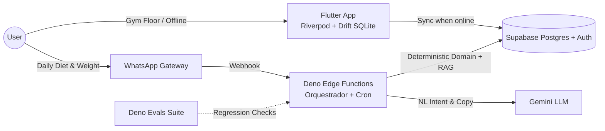

# LIFTR — Offline-First Workout OS & WhatsApp AI Companion

> **Open the app, see today's workout, log your sets offline, and handle nutrition, body weight, and weekly reviews via WhatsApp.**

LIFTR unifies a deterministic, offline-first Flutter workout engine with a Deno/Supabase Edge Functions backend for conversational logging, RAG-assisted guidance, and automated LLM evaluations.

---

## Architecture Overview



### Core Design Principles

1. **Focused Mobile Surface (3 Primary Tabs):** The primary shell keeps the gym-floor experience uncluttered (`Hoje` · `Treino` · `Progresso`), while secondary tracking modules remain decoupled from the main navigation bar and high-frequency diet/weight capture shifts to WhatsApp.
2. **Offline-First Persistence:** Local SQLite via Drift + Riverpod reactive state + deterministic progression and insights engine (no LLM dependency inside workout calculations).
3. **LLM Guardrails & Evals:** All numerical calculations stay deterministic in TypeScript/Dart domain logic; the LLM only parses natural language and formats responses, covered by automated tests in `evals/`.
4. **Runtime Secrets Hygiene:** Client builds inject Supabase settings at compile time via `--dart-define` (never committed in source).

---

## Repository Structure

```text
LIFTR/
├── app/                     # Flutter mobile client (Clean Architecture, Drift, Riverpod, Freezed, 225+ tests)
├── supabase/
│   ├── migrations/          # Postgres schema & RLS migrations
│   ├── seed/                # Initial exercise catalog seed
│   └── functions/           # Deno Edge Functions (whatsapp-webhook, orquestrador, cron-relatorio-semanal)
├── skills/                  # Modular AI skill prompts & shared domain templates
├── evals/                   # Automated evaluator runner and assertions for LLM pipelines
├── docs/
│   ├── PRD.md               # Product Requirements Document
│   ├── adr/                 # Architecture Decision Records (001–005)
│   ├── architecture/        # Mobile architecture docs
│   ├── database/            # Data modeling docs
│   └── sdd/                 # Software Design Documents
├── deno.json                # Deno tasks (lint, check, test, evals)
└── .github/workflows/ci.yml # CI pipeline for Flutter + Deno
```

---

## Quick Start

### 1. Flutter App (`app/`)

```bash
cd app
flutter pub get

# Run tests (offline-first, works without cloud env)
flutter analyze
flutter test

# Run with Supabase sync enabled
flutter run \
  --dart-define=SUPABASE_URL=https://your-project.supabase.co \
  --dart-define=SUPABASE_ANON_KEY=your-anon-key
```

### 2. Edge Functions & Evals (`supabase/` & `evals/`)

```bash
cp .env.example .env
deno lint
deno task check
deno test --allow-read --allow-env supabase/functions evals
```

---

## Architecture Decision Records

- [ADR 001 — Dupla Progressão e Offline-First](docs/adr/001-dupla-progressao-e-offline-first.md)
- [ADR 002 — Integração WhatsApp Gateway](docs/adr/002-integracao-whatsapp-gateway.md)
- [ADR 003 — Arquitetura IA, RAG e Provedor LLM](docs/adr/003-arquitetura-ia-rag-e-provedor-llm.md)
- [ADR 004 — Modelagem de Séries Individuais](docs/adr/004-modelagem-series-individuais.md)
- [ADR 005 — Autenticação, Vínculo WhatsApp e Catálogo](docs/adr/005-autenticacao-vinculo-whatsapp-e-catalogo.md)
