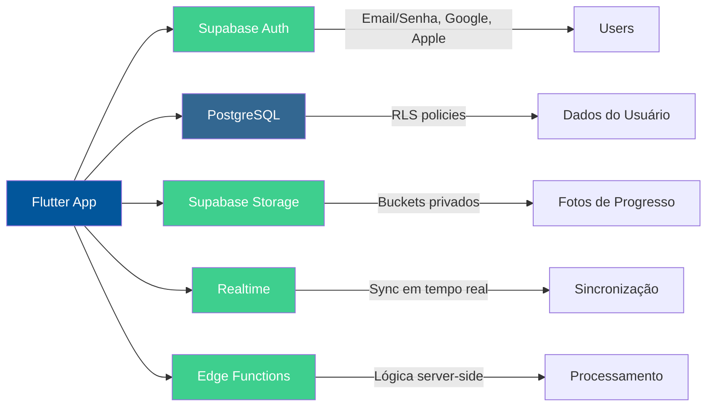
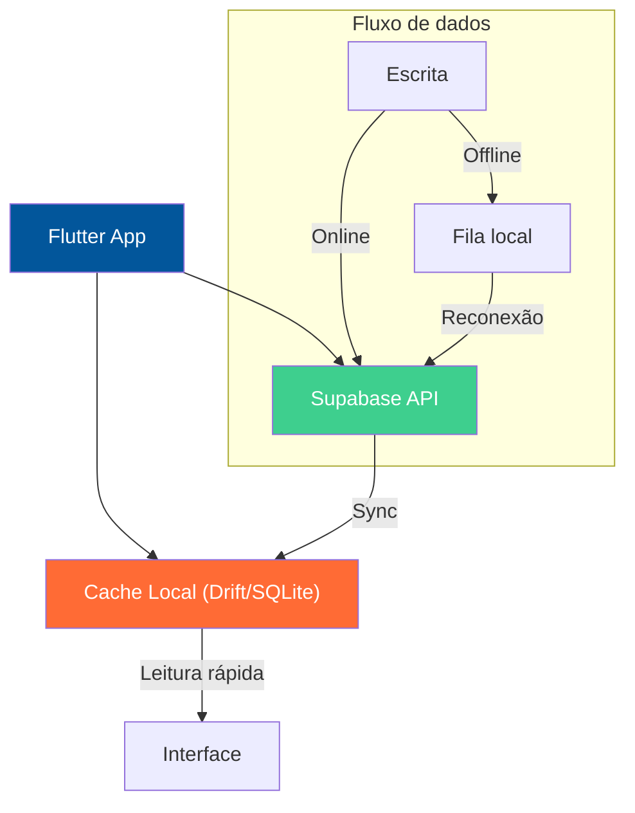

# Personal Fitness OS — Technology Stack

## Stack Principal

| Camada | Tecnologia | Justificativa |
|--------|-----------|---------------|
| **Mobile/Web** | Flutter (Dart) | Cross-platform (iOS + Android + Web) com código único. Widgets customizáveis, excelente performance, ecossistema maduro |
| **Backend/BaaS** | Supabase | PostgreSQL gerenciado + Auth + Storage + Realtime + Edge Functions. Free tier generoso. SDK oficial para Flutter |
| **Banco de Dados** | PostgreSQL (via Supabase) | Relacional, robusto, RLS (Row Level Security) nativo, ótimo para dados estruturados e históricos |
| **Autenticação** | Supabase Auth | Email/senha, OAuth (Google, Apple), magic link. Pronto para uso |
| **Storage** | Supabase Storage | Fotos de progresso, vídeos de referência. Políticas de acesso granulares |
| **Linguagem** | Dart | Tipado, null-safe, ótimo tooling, integrado ao Flutter |

---

## Arquitetura do Monorepo

```
workout-creator/
├── docs/                          # Documentação do projeto
├── lib/                           # Código-fonte principal do Flutter
│   ├── core/                      # Camada compartilhada
│   │   ├── constants/             # Constantes globais
│   │   ├── errors/                # Classes de erro/exceção
│   │   ├── extensions/            # Extensions do Dart
│   │   ├── theme/                 # Design system, cores, tipografia
│   │   ├── utils/                 # Utilitários genéricos
│   │   └── widgets/               # Widgets reutilizáveis
│   │
│   ├── features/                  # Feature modules (por domínio)
│   │   ├── auth/                  # Autenticação
│   │   │   ├── data/              # Repositórios, data sources
│   │   │   ├── domain/            # Entities, use cases, interfaces
│   │   │   └── presentation/      # Screens, widgets, state
│   │   │
│   │   ├── dashboard/
│   │   │   ├── data/
│   │   │   ├── domain/
│   │   │   └── presentation/
│   │   │
│   │   ├── training/              # Treinos + programas
│   │   │   ├── data/
│   │   │   ├── domain/
│   │   │   └── presentation/
│   │   │
│   │   ├── workout_session/       # Execução de treino
│   │   │   ├── data/
│   │   │   ├── domain/
│   │   │   └── presentation/
│   │   │
│   │   ├── exercise_library/      # Biblioteca de exercícios
│   │   │   ├── data/
│   │   │   ├── domain/
│   │   │   └── presentation/
│   │   │
│   │   ├── progression/           # Motor de progressão
│   │   │   ├── data/
│   │   │   ├── domain/
│   │   │   └── presentation/
│   │   │
│   │   ├── body/                  # Peso + medidas + fotos
│   │   │   ├── data/
│   │   │   ├── domain/
│   │   │   └── presentation/
│   │   │
│   │   ├── nutrition/             # Calorias, macros, refeições
│   │   │   ├── data/
│   │   │   ├── domain/
│   │   │   └── presentation/
│   │   │
│   │   ├── goals/                 # Metas
│   │   │   ├── data/
│   │   │   ├── domain/
│   │   │   └── presentation/
│   │   │
│   │   └── history/               # Histórico + timeline
│   │       ├── data/
│   │       ├── domain/
│   │       └── presentation/
│   │
│   ├── routing/                   # Navegação (GoRouter)
│   └── app.dart                   # Entry point da aplicação
│
├── test/                          # Testes (espelha estrutura de lib/)
│   ├── core/
│   ├── features/
│   └── integration/
│
├── assets/                        # Assets estáticos
│   ├── icons/
│   ├── images/
│   └── fonts/
│
├── supabase/                      # Configuração Supabase
│   ├── migrations/                # Migrações SQL do banco
│   ├── functions/                 # Edge Functions (Deno/TypeScript)
│   ├── seed.sql                   # Dados iniciais
│   └── config.toml                # Config do projeto Supabase
│
├── pubspec.yaml                   # Dependências do Flutter
├── analysis_options.yaml          # Regras de lint
└── README.md
```

---

## Pacotes Flutter Recomendados

### Core

| Pacote | Propósito |
|--------|-----------|
| `supabase_flutter` | SDK oficial Supabase para Flutter |
| `flutter_riverpod` / `riverpod` | State management reativo e testável |
| `riverpod_annotation` + `riverpod_generator` | Code generation para providers |
| `go_router` | Navegação declarativa, deep linking |
| `freezed` + `freezed_annotation` | Imutabilidade, union types, copyWith |
| `json_annotation` + `json_serializable` | Serialização JSON |
| `build_runner` | Code generation |

### UI

| Pacote | Propósito |
|--------|-----------|
| `flutter_animate` | Animações declarativas |
| `fl_chart` | Gráficos (peso, progressão, calorias) |
| `cached_network_image` | Cache de imagens |
| `flutter_svg` | Ícones SVG |
| `shimmer` | Loading skeletons |
| `intl` | Internacionalização e formatação |

### Funcionalidade

| Pacote | Propósito |
|--------|-----------|
| `image_picker` | Seleção de fotos (câmera/galeria) |
| `path_provider` | Acesso ao filesystem |
| `drift` | Banco local SQLite (cache offline) |
| `connectivity_plus` | Detecção de conectividade |
| `uuid` | Geração de IDs estáveis |
| `envied` | Variáveis de ambiente seguras |

### Dev/Quality

| Pacote | Propósito |
|--------|-----------|
| `flutter_test` | Testes unitários e de widget |
| `mocktail` | Mocking para testes |
| `very_good_analysis` | Regras de lint opinativas e rigorosas |
| `patrol` | Testes de integração (opcional) |

---

## Supabase — Serviços Utilizados



### Row Level Security (RLS)

Todas as tabelas terão políticas RLS que garantem que cada usuário só acessa seus próprios dados:

```sql
-- Exemplo de política RLS
CREATE POLICY "Users can only access their own data"
ON weight_entries
FOR ALL
USING (auth.uid() = user_id);
```

---

## Estratégia de Offline

Para o MVP, o app funcionará **online-first** com cache local básico:



**MVP:** Cache de leitura + fila de escrita básica  
**v1.1+:** Sincronização bidirecional completa com resolução de conflitos

---

## Ambientes

| Ambiente | Supabase Project | Uso |
|----------|-----------------|-----|
| `development` | Local (Supabase CLI) | Desenvolvimento local |
| `staging` | Projeto Supabase separado | Testes antes de produção |
| `production` | Projeto Supabase principal | Usuários reais |

O Supabase CLI permite rodar todo o stack localmente (PostgreSQL, Auth, Storage) durante o desenvolvimento.

---

## Custos Estimados (MVP)

| Serviço | Plano | Custo |
|---------|-------|-------|
| Supabase | Free tier | R$ 0/mês |
| ↳ Database | 500MB | Incluso |
| ↳ Auth | 50.000 MAU | Incluso |
| ↳ Storage | 1GB | Incluso |
| ↳ Edge Functions | 500K invocações | Incluso |
| Apple Developer | Publicação iOS | ~R$ 500/ano |
| Google Play | Publicação Android | ~R$ 130 (único) |
| **Total MVP** | | **~R$ 0/mês** (sem lojas) |

> [!NOTE]
> O free tier do Supabase é mais que suficiente para uso pessoal e alguns amigos. Upgrade para Pro (~$25/mês) só seria necessário com dezenas de usuários ativos.
