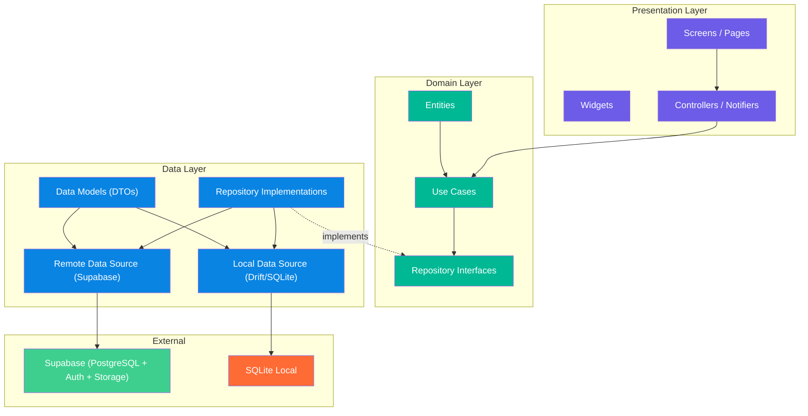
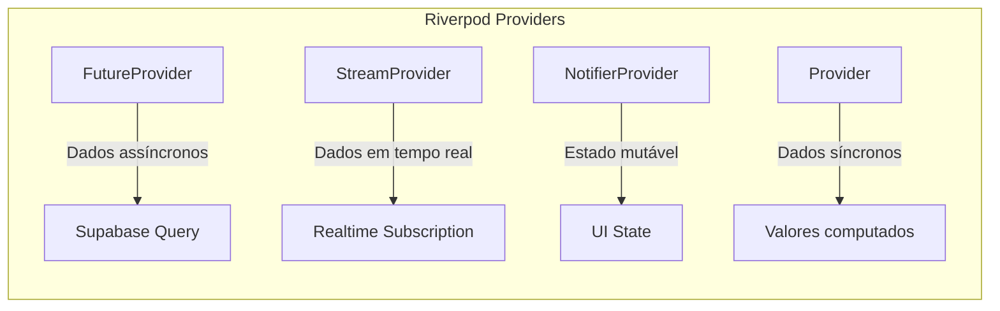
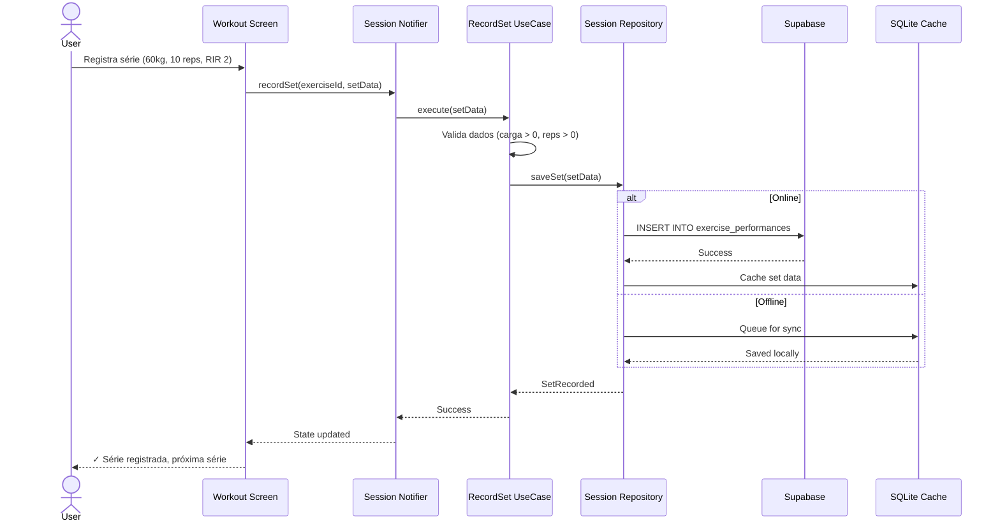
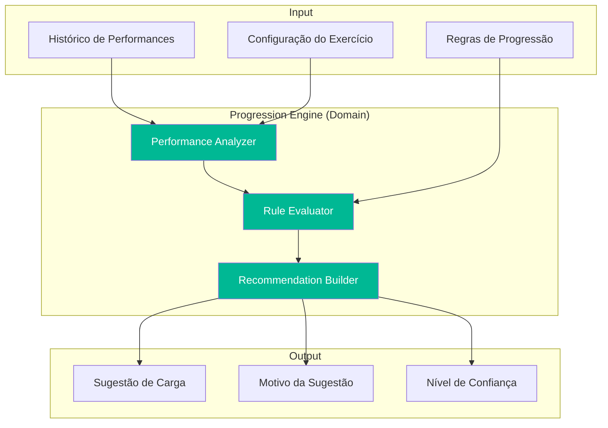
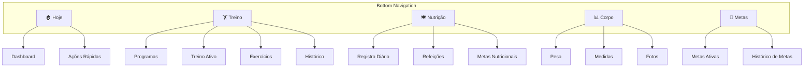
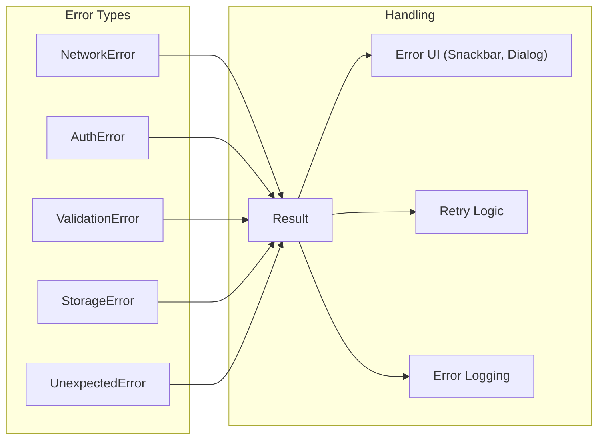

# Personal Fitness OS — Arquitetura do Sistema

## Visão Geral

A arquitetura segue o padrão **Clean Architecture** adaptado para Flutter, com separação clara entre camadas e responsabilidades. Cada feature é um módulo independente que segue a mesma estrutura interna.



---

## Camadas

### 1. Presentation Layer (Roxo)

**Responsabilidade:** Interface do usuário e estado da UI.

| Componente | Papel |
|-----------|-------|
| **Screens** | Páginas completas (DashboardScreen, WorkoutScreen) |
| **Widgets** | Componentes reutilizáveis da feature |
| **Controllers/Notifiers** | Gerenciam estado da UI via Riverpod. Chamam use cases |

**Regras:**
- Nunca acessa banco de dados ou API diretamente
- Nunca contém regras de negócio (ex: lógica de progressão)
- Apenas chama use cases e reage ao estado

### 2. Domain Layer (Verde)

**Responsabilidade:** Regras de negócio puras, independentes de framework.

| Componente | Papel |
|-----------|-------|
| **Entities** | Objetos de domínio imutáveis (Exercise, Workout, WeightEntry) |
| **Use Cases** | Operações de negócio (RecordWorkoutSession, CalculateProgression) |
| **Repository Interfaces** | Contratos abstratos que a camada de dados implementa |

**Regras:**
- Zero dependências de Flutter, Supabase ou qualquer pacote externo
- Dart puro — pode ser testado unitariamente sem mocks de framework
- **É aqui que vivem as regras de progressão de carga**

### 3. Data Layer (Azul)

**Responsabilidade:** Acesso a dados e transformação.

| Componente | Papel |
|-----------|-------|
| **Repository Impls** | Implementam as interfaces do domínio |
| **Remote Data Source** | Comunicação com Supabase (queries, inserts, RPC) |
| **Local Data Source** | Cache local SQLite via Drift |
| **Models (DTOs)** | Data Transfer Objects para serialização/deserialização |

**Regras:**
- Transforma DTOs ↔ Entities
- Decide se busca do cache local ou da API remota
- Implementa estratégia de sync/cache

---

## Padrão por Feature

Cada feature segue a mesma estrutura:

```
lib/features/training/
├── data/
│   ├── datasources/
│   │   ├── training_remote_datasource.dart
│   │   └── training_local_datasource.dart
│   ├── models/
│   │   ├── training_plan_model.dart
│   │   └── workout_model.dart
│   └── repositories/
│       └── training_repository_impl.dart
│
├── domain/
│   ├── entities/
│   │   ├── training_plan.dart
│   │   └── workout.dart
│   ├── repositories/
│   │   └── training_repository.dart          # Interface abstrata
│   └── usecases/
│       ├── create_training_plan.dart
│       ├── get_active_training_plan.dart
│       ├── get_today_workout.dart
│       └── reorder_exercises.dart
│
└── presentation/
    ├── screens/
    │   ├── training_plan_screen.dart
    │   ├── workout_detail_screen.dart
    │   └── create_training_plan_screen.dart
    ├── widgets/
    │   ├── exercise_card.dart
    │   ├── set_row.dart
    │   └── workout_summary_card.dart
    └── providers/
        ├── training_providers.dart
        └── workout_state.dart
```

---

## State Management — Riverpod

O Riverpod foi escolhido por ser:
- **Compile-safe** — erros de estado são pegos em tempo de compilação
- **Testável** — providers podem ser overridden em testes
- **Reativo** — UI reage automaticamente a mudanças de estado
- **Sem BuildContext** — providers são independentes da árvore de widgets

### Tipos de Providers



### Exemplo de Fluxo

```
UserTapsStartWorkout
    ↓
WorkoutSessionNotifier.start(workoutId)
    ↓
StartWorkoutSessionUseCase.execute(workoutId)
    ↓
WorkoutSessionRepository.createSession(...)
    ↓
SupabaseRemoteDataSource.insert('workout_sessions', ...)
    ↓
State atualizado → UI reage automaticamente
```

---

## Fluxo de Dados — Registro de Treino



---

## Motor de Progressão — Arquitetura

O motor de progressão é **puro domínio** — sem dependência de UI ou banco de dados.



### Regras de Progressão (Exemplos)

```dart
// Pseudocódigo — a lógica real será implementada no domain layer
enum ProgressionAction { increase, maintain, decrease }

ProgressionAction evaluate({
  required List<SetPerformance> lastSessionSets,
  required RepRange targetRepRange,    // ex: 6-10
  required RirRange targetRirRange,    // ex: 1-2
  required bool goodExecution,
}) {
  final allHitTopOfRange = lastSessionSets.every(
    (s) => s.reps >= targetRepRange.max
  );
  final rirInRange = lastSessionSets.every(
    (s) => s.rir >= targetRirRange.min && s.rir <= targetRirRange.max
  );

  if (allHitTopOfRange && rirInRange && goodExecution) {
    return ProgressionAction.increase;
  }
  
  if (!goodExecution || lastSessionSets.any((s) => s.rir < targetRirRange.min)) {
    return ProgressionAction.decrease;
  }
  
  return ProgressionAction.maintain;
}
```

---

## Navegação



Navegação via **GoRouter** com deep linking:

```
/                          → Dashboard (Hoje)
/training                  → Lista de programas
/training/:planId          → Detalhes do programa
/training/:planId/workout/:workoutId  → Treino específico
/session/:sessionId        → Sessão de treino ativa
/nutrition                 → Registro nutricional
/body                      → Dados corporais
/body/weight               → Histórico de peso
/goals                     → Metas
/history                   → Timeline geral
```

---

## Tratamento de Erros



Usar um tipo `Result<Success, Failure>` (ou `Either`) para propagar erros de forma type-safe, sem exceptions não tratadas.

---

## Testes

| Tipo | O que testa | Onde | Cobertura alvo |
|------|------------|------|---------------|
| **Unit** | Entities, Use Cases, Regras de progressão | `test/features/*/domain/` | 90%+ |
| **Widget** | Componentes visuais isolados | `test/features/*/presentation/` | 70%+ |
| **Integration** | Fluxos completos (registrar treino, etc.) | `test/integration/` | Fluxos críticos |
| **Golden** | Snapshots visuais de widgets | `test/golden/` | Componentes chave |

> [!IMPORTANT]
> O motor de progressão **DEVE** ter cobertura de testes unitários próxima de 100%. É a parte mais crítica do sistema e precisa ser previsível.
