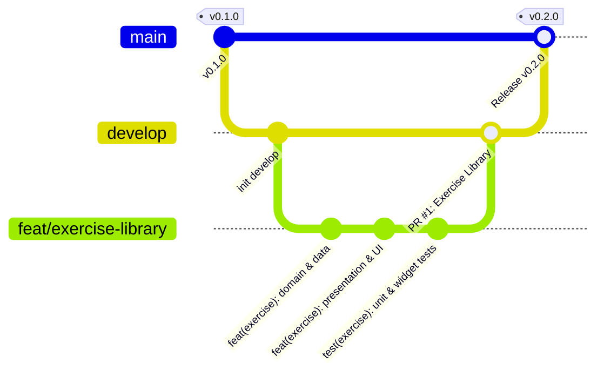

# Fluxo de Versionamento e Git Workflow

Este documento estabelece o fluxo de trabalho Git oficial do projeto **Personal Fitness OS (LIFTR)**.

---

## 1. Estrutura de Branches

```
main (produção / releases estáveis / tags)
  ▲
  │ (PR de Release)
develop (integração / desenvolvimento contínuo)
  ▲
  │ (PR de Feature / Bugfix)
feat/* | fix/* | chore/* (branches de trabalho)
```

| Branch | Propósito | Origem | Destino (Merge via PR) |
|---|---|---|---|
| `main` | Código de produção estável. Cada merge gera uma tag de versão (`v0.1.0`, `v0.2.0`). | - | - |
| `develop` | Branch principal de desenvolvimento e integração de features. | `main` | `main` (via release) |
| `feat/<nome>` | Desenvolvimento de uma nova feature ou conjunto de tasks SDD. | `develop` | `develop` |
| `fix/<nome>` | Correção de bugs. | `develop` | `develop` |
| `chore/<nome>` | Manutenções de infraestrutura, dependências ou configs. | `develop` | `develop` |
| `hotfix/<nome>` | Correções emergenciais em produção. | `main` | `main` e `develop` |

---

## 2. Ciclo de Vida de uma Feature



### Passo a passo obrigatório:

1. **Atualizar `develop`:**
   ```bash
   git checkout develop
   git pull origin develop
   ```

2. **Criar a branch da feature:**
   ```bash
   git checkout -b feat/<nome-da-feature>
   ```

3. **Desenvolver com commits atômicos (Conventional Commits):**
   - Um commit por objetivo técnico claro.
   - Mensagens claras com escopo: `feat(exercise): implement exercise repository`.

4. **Testes e Verificação:**
   - Executar `flutter analyze` e `flutter test` antes de abrir o PR.
   - Garantir 0 erros de compilação e lint.

5. **Pull Request para `develop`:**
   - Abrir PR de `feat/<nome-da-feature>` apontando para `develop`.
   - Revisão e validação dos critérios de aceitação da task/spec.
   - Merge na `develop`.

6. **Release para `main`:**
   - Quando uma fase/marco do roadmap estiver completo na `develop`:
   - Abrir PR de `develop` para `main`.
   - Gerar a tag semver correspondente na `main` (ex: `v0.2.0`).
   - Publicar a nova versão.

---

## 3. Padrão de Commits (Conventional Commits)

Formato: `<tipo>(<escopo opcional>): <descrição em minúsculas>`

### Tipos permitidos:
- **`feat`**: Nova funcionalidade de produto ou arquitetura.
- **`fix`**: Correção de bug.
- **`docs`**: Alterações exclusivamente em documentação.
- **`style`**: Formatação de código sem alteração lógica.
- **`refactor`**: Refatoração de código sem mudar comportamento.
- **`test`**: Adição ou correção de testes.
- **`chore`**: Atualização de build, dependências, scripts ou configs.

### Exemplos:
- `feat(exercise): add exercise list screen with search and filters`
- `fix(progression): fix RIR calculation edge case for working sets`
- `docs(sdd): add task specification for EXERCISE-001`
- `test(progression): add unit tests for load progression engine`

---

## 4. Integração com GitHub CLI (`gh` via Host)

No ambiente de execução do agente (sandbox/Flatpak), comandos do GitHub CLI (`gh`) devem ser invocados através do host:

```bash
# Verificar status de autenticação
flatpak-spawn --host gh auth status

# Criar Pull Request para develop ao finalizar uma feature:
flatpak-spawn --host gh pr create --base develop --head feat/<nome-da-feature> --title "feat(<escopo>): <título>" --body "<resumo das mudanças e critérios de aceitação>"

# Criar Pull Request de Release para main ao finalizar uma fase:
flatpak-spawn --host gh pr create --base main --head develop --title "release: vX.Y.Z" --body "<changelog da fase>"
```

