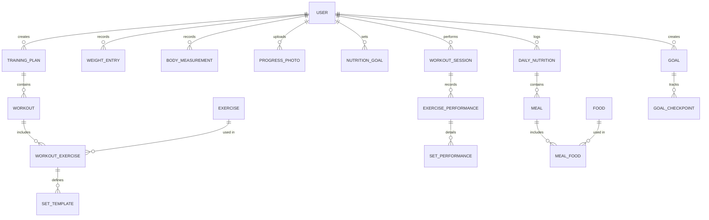
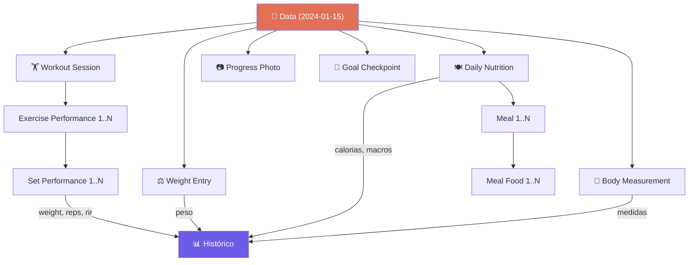

# Personal Fitness OS — Modelo de Dados

## Visão Geral

O modelo de dados é relacional (PostgreSQL via Supabase) e segue os princípios:

1. **Tudo vinculado ao usuário** — RLS garante isolamento
2. **Tudo vinculado a datas** — linha do tempo é o eixo central
3. **IDs estáveis (UUID)** — nunca usar nomes como chave primária
4. **Histórico preservado** — dados nunca sobrescritos silenciosamente
5. **Soft delete** — registros deletados são marcados, não removidos

---

## Diagrama de Entidade-Relacionamento (ERD)



---

## Entidades Detalhadas

### User Profile

> Perfil do usuário, complementar ao `auth.users` do Supabase.

```sql
CREATE TABLE user_profiles (
    id UUID PRIMARY KEY REFERENCES auth.users(id) ON DELETE CASCADE,
    display_name TEXT NOT NULL,
    date_of_birth DATE,
    gender TEXT CHECK (gender IN ('male', 'female', 'other', 'prefer_not_to_say')),
    height_cm NUMERIC(5,1),
    preferred_weight_unit TEXT DEFAULT 'kg' CHECK (preferred_weight_unit IN ('kg', 'lbs')),
    preferred_measurement_unit TEXT DEFAULT 'cm' CHECK (preferred_measurement_unit IN ('cm', 'in')),
    timezone TEXT DEFAULT 'America/Sao_Paulo',
    created_at TIMESTAMPTZ DEFAULT NOW(),
    updated_at TIMESTAMPTZ DEFAULT NOW()
);
```

---

### Training Plan (Programa de Treino)

```sql
CREATE TABLE training_plans (
    id UUID PRIMARY KEY DEFAULT gen_random_uuid(),
    user_id UUID NOT NULL REFERENCES auth.users(id) ON DELETE CASCADE,
    name TEXT NOT NULL,                          -- "Upper/Lower Especialização"
    description TEXT,
    is_active BOOLEAN DEFAULT false,             -- Apenas 1 ativo por vez
    start_date DATE,
    end_date DATE,
    created_at TIMESTAMPTZ DEFAULT NOW(),
    updated_at TIMESTAMPTZ DEFAULT NOW(),
    deleted_at TIMESTAMPTZ                       -- Soft delete
);

-- Índices
CREATE INDEX idx_training_plans_user ON training_plans(user_id);
CREATE INDEX idx_training_plans_active ON training_plans(user_id, is_active) WHERE is_active = true;
```

### Workout (Treino do Dia)

```sql
CREATE TABLE workouts (
    id UUID PRIMARY KEY DEFAULT gen_random_uuid(),
    training_plan_id UUID NOT NULL REFERENCES training_plans(id) ON DELETE CASCADE,
    name TEXT NOT NULL,                          -- "Upper A", "Lower B"
    day_of_week INTEGER CHECK (day_of_week BETWEEN 0 AND 6),  -- 0=Dom, 1=Seg...
    sort_order INTEGER NOT NULL DEFAULT 0,       -- Ordem no programa
    notes TEXT,
    estimated_duration_minutes INTEGER,
    created_at TIMESTAMPTZ DEFAULT NOW(),
    updated_at TIMESTAMPTZ DEFAULT NOW()
);

CREATE INDEX idx_workouts_plan ON workouts(training_plan_id);
```

---

### Exercise (Exercício — Biblioteca)

```sql
CREATE TABLE exercises (
    id UUID PRIMARY KEY DEFAULT gen_random_uuid(),
    user_id UUID REFERENCES auth.users(id) ON DELETE CASCADE,  -- NULL = exercício global
    name TEXT NOT NULL,
    primary_muscle_group TEXT NOT NULL,           -- "chest", "back", "quadriceps"
    secondary_muscles TEXT[],                     -- ["anterior_deltoid", "triceps"]
    equipment TEXT,                               -- "barbell", "dumbbell", "cable", "bodyweight"
    movement_pattern TEXT,                        -- "horizontal_push", "vertical_pull", "hip_hinge"
    instructions TEXT,
    common_mistakes TEXT,
    video_url TEXT,
    personal_notes TEXT,                          -- Observações pessoais do usuário
    is_custom BOOLEAN DEFAULT false,              -- Exercício criado pelo usuário
    created_at TIMESTAMPTZ DEFAULT NOW(),
    updated_at TIMESTAMPTZ DEFAULT NOW(),
    deleted_at TIMESTAMPTZ
);

CREATE INDEX idx_exercises_muscle ON exercises(primary_muscle_group);
CREATE INDEX idx_exercises_user ON exercises(user_id);
```

### Workout Exercise (Exercício dentro de um Treino)

```sql
CREATE TABLE workout_exercises (
    id UUID PRIMARY KEY DEFAULT gen_random_uuid(),
    workout_id UUID NOT NULL REFERENCES workouts(id) ON DELETE CASCADE,
    exercise_id UUID NOT NULL REFERENCES exercises(id),
    sort_order INTEGER NOT NULL DEFAULT 0,
    notes TEXT,
    
    -- Substituição de exercício (preserva histórico)
    replaced_exercise_id UUID REFERENCES exercises(id),
    replaced_at TIMESTAMPTZ,
    
    created_at TIMESTAMPTZ DEFAULT NOW(),
    updated_at TIMESTAMPTZ DEFAULT NOW()
);

CREATE INDEX idx_workout_exercises_workout ON workout_exercises(workout_id);
```

### Set Template (Template de Série)

```sql
CREATE TYPE set_type AS ENUM ('mobility', 'warmup', 'ramp_up', 'working');

CREATE TABLE set_templates (
    id UUID PRIMARY KEY DEFAULT gen_random_uuid(),
    workout_exercise_id UUID NOT NULL REFERENCES workout_exercises(id) ON DELETE CASCADE,
    set_number INTEGER NOT NULL,                 -- 1, 2, 3...
    set_type set_type NOT NULL DEFAULT 'working',
    
    -- Targets
    target_reps_min INTEGER,                     -- 6
    target_reps_max INTEGER,                     -- 10
    target_rir_min INTEGER,                      -- 1
    target_rir_max INTEGER,                      -- 2
    target_weight NUMERIC(6,2),                  -- kg
    rest_seconds INTEGER DEFAULT 120,            -- Descanso em segundos
    
    notes TEXT,
    created_at TIMESTAMPTZ DEFAULT NOW(),
    updated_at TIMESTAMPTZ DEFAULT NOW()
);

CREATE INDEX idx_set_templates_exercise ON set_templates(workout_exercise_id);
```

> [!NOTE]
> **set_type**: `mobility` = mobilidade, `warmup` = aquecimento, `ramp_up` = reconhecimento/aproximação, `working` = válida. Apenas séries `working` entram no cálculo de volume efetivo e progressão.

---

### Workout Session (Sessão de Treino Realizada)

```sql
CREATE TABLE workout_sessions (
    id UUID PRIMARY KEY DEFAULT gen_random_uuid(),
    user_id UUID NOT NULL REFERENCES auth.users(id) ON DELETE CASCADE,
    workout_id UUID NOT NULL REFERENCES workouts(id),
    training_plan_id UUID REFERENCES training_plans(id),
    
    started_at TIMESTAMPTZ NOT NULL,
    completed_at TIMESTAMPTZ,
    duration_minutes INTEGER,
    
    -- Percepção geral
    overall_difficulty INTEGER CHECK (overall_difficulty BETWEEN 1 AND 10),  -- RPE da sessão
    overall_notes TEXT,
    mood TEXT CHECK (mood IN ('great', 'good', 'neutral', 'bad', 'terrible')),
    
    status TEXT DEFAULT 'in_progress' CHECK (status IN ('in_progress', 'completed', 'abandoned')),
    
    created_at TIMESTAMPTZ DEFAULT NOW(),
    updated_at TIMESTAMPTZ DEFAULT NOW()
);

CREATE INDEX idx_sessions_user ON workout_sessions(user_id);
CREATE INDEX idx_sessions_workout ON workout_sessions(workout_id);
CREATE INDEX idx_sessions_date ON workout_sessions(user_id, started_at);
```

### Exercise Performance (Performance por Exercício na Sessão)

```sql
CREATE TABLE exercise_performances (
    id UUID PRIMARY KEY DEFAULT gen_random_uuid(),
    workout_session_id UUID NOT NULL REFERENCES workout_sessions(id) ON DELETE CASCADE,
    workout_exercise_id UUID NOT NULL REFERENCES workout_exercises(id),
    exercise_id UUID NOT NULL REFERENCES exercises(id),
    
    sort_order INTEGER NOT NULL DEFAULT 0,
    notes TEXT,
    
    created_at TIMESTAMPTZ DEFAULT NOW(),
    updated_at TIMESTAMPTZ DEFAULT NOW()
);

CREATE INDEX idx_performances_session ON exercise_performances(workout_session_id);
CREATE INDEX idx_performances_exercise ON exercise_performances(exercise_id);
```

### Set Performance (Performance por Série)

```sql
CREATE TABLE set_performances (
    id UUID PRIMARY KEY DEFAULT gen_random_uuid(),
    exercise_performance_id UUID NOT NULL REFERENCES exercise_performances(id) ON DELETE CASCADE,
    set_template_id UUID REFERENCES set_templates(id),
    
    set_number INTEGER NOT NULL,
    set_type set_type NOT NULL DEFAULT 'working',
    
    -- Realizado
    weight NUMERIC(6,2),                          -- kg reais usados
    reps INTEGER,                                 -- Repetições realizadas
    rir INTEGER,                                  -- RIR real
    rest_seconds INTEGER,                         -- Descanso real
    
    -- Qualidade
    execution_quality TEXT CHECK (execution_quality IN ('good', 'moderate', 'poor')),
    perceived_difficulty INTEGER CHECK (perceived_difficulty BETWEEN 1 AND 10),
    
    -- Progressão
    weight_suggested NUMERIC(6,2),                -- Carga sugerida pelo motor
    progression_action TEXT,                       -- 'increase', 'maintain', 'decrease'
    progression_reason TEXT,                       -- Motivo da sugestão
    
    notes TEXT,
    performed_at TIMESTAMPTZ DEFAULT NOW(),
    created_at TIMESTAMPTZ DEFAULT NOW()
);

CREATE INDEX idx_set_perf_exercise ON set_performances(exercise_performance_id);
```

---

### Weight Entry (Registro de Peso)

```sql
CREATE TABLE weight_entries (
    id UUID PRIMARY KEY DEFAULT gen_random_uuid(),
    user_id UUID NOT NULL REFERENCES auth.users(id) ON DELETE CASCADE,
    weight NUMERIC(5,2) NOT NULL,                -- kg
    measured_at TIMESTAMPTZ NOT NULL DEFAULT NOW(),
    notes TEXT,
    created_at TIMESTAMPTZ DEFAULT NOW()
);

CREATE INDEX idx_weight_user_date ON weight_entries(user_id, measured_at);
```

### Body Measurement (Medidas Corporais)

```sql
CREATE TABLE body_measurements (
    id UUID PRIMARY KEY DEFAULT gen_random_uuid(),
    user_id UUID NOT NULL REFERENCES auth.users(id) ON DELETE CASCADE,
    measured_at TIMESTAMPTZ NOT NULL DEFAULT NOW(),
    
    -- Medidas padrão (cm)
    waist NUMERIC(5,1),
    chest NUMERIC(5,1),
    arm_left NUMERIC(5,1),
    arm_right NUMERIC(5,1),
    thigh_left NUMERIC(5,1),
    thigh_right NUMERIC(5,1),
    calf_left NUMERIC(5,1),
    calf_right NUMERIC(5,1),
    hip NUMERIC(5,1),
    shoulder NUMERIC(5,1),
    neck NUMERIC(5,1),
    forearm_left NUMERIC(5,1),
    forearm_right NUMERIC(5,1),
    
    notes TEXT,
    created_at TIMESTAMPTZ DEFAULT NOW()
);

-- Medidas customizadas
CREATE TABLE custom_measurements (
    id UUID PRIMARY KEY DEFAULT gen_random_uuid(),
    body_measurement_id UUID NOT NULL REFERENCES body_measurements(id) ON DELETE CASCADE,
    name TEXT NOT NULL,                           -- "antebraço esquerdo", etc.
    value NUMERIC(5,1) NOT NULL,
    unit TEXT DEFAULT 'cm'
);

CREATE INDEX idx_body_user_date ON body_measurements(user_id, measured_at);
```

### Progress Photo (Fotos de Progresso)

```sql
CREATE TABLE progress_photos (
    id UUID PRIMARY KEY DEFAULT gen_random_uuid(),
    user_id UUID NOT NULL REFERENCES auth.users(id) ON DELETE CASCADE,
    photo_url TEXT NOT NULL,                      -- URL do Supabase Storage
    storage_path TEXT NOT NULL,                   -- Path no bucket para deletar
    taken_at TIMESTAMPTZ NOT NULL DEFAULT NOW(),
    pose TEXT,                                    -- "front_relaxed", "side_left", "back_lat_spread"
    notes TEXT,
    created_at TIMESTAMPTZ DEFAULT NOW()
);

CREATE INDEX idx_photos_user_date ON progress_photos(user_id, taken_at);
```

---

### Nutrition Goal (Meta Nutricional)

```sql
CREATE TABLE nutrition_goals (
    id UUID PRIMARY KEY DEFAULT gen_random_uuid(),
    user_id UUID NOT NULL REFERENCES auth.users(id) ON DELETE CASCADE,
    
    calories INTEGER NOT NULL,                    -- kcal/dia
    protein_grams INTEGER NOT NULL,               -- g/dia
    carbs_grams INTEGER NOT NULL,                 -- g/dia
    fat_grams INTEGER NOT NULL,                   -- g/dia
    
    effective_from DATE NOT NULL DEFAULT CURRENT_DATE,
    effective_until DATE,                          -- NULL = meta ativa
    
    notes TEXT,
    created_at TIMESTAMPTZ DEFAULT NOW()
);

CREATE INDEX idx_nutrition_goals_user ON nutrition_goals(user_id, effective_from);
```

### Food (Alimento)

```sql
CREATE TABLE foods (
    id UUID PRIMARY KEY DEFAULT gen_random_uuid(),
    user_id UUID REFERENCES auth.users(id) ON DELETE CASCADE,  -- NULL = alimento global
    
    name TEXT NOT NULL,
    brand TEXT,
    serving_size NUMERIC(7,2) NOT NULL,           -- Porção em gramas
    serving_unit TEXT DEFAULT 'g',
    
    -- Por porção
    calories NUMERIC(7,2),
    protein NUMERIC(6,2),
    carbs NUMERIC(6,2),
    fat NUMERIC(6,2),
    fiber NUMERIC(6,2),
    
    barcode TEXT,                                  -- EAN/UPC para busca futura
    is_custom BOOLEAN DEFAULT false,
    
    created_at TIMESTAMPTZ DEFAULT NOW(),
    updated_at TIMESTAMPTZ DEFAULT NOW()
);

CREATE INDEX idx_foods_name ON foods USING gin(to_tsvector('portuguese', name));
CREATE INDEX idx_foods_user ON foods(user_id);
```

### Daily Nutrition (Registro Diário)

```sql
CREATE TABLE daily_nutrition (
    id UUID PRIMARY KEY DEFAULT gen_random_uuid(),
    user_id UUID NOT NULL REFERENCES auth.users(id) ON DELETE CASCADE,
    date DATE NOT NULL,
    
    -- Totais calculados
    total_calories NUMERIC(7,2) DEFAULT 0,
    total_protein NUMERIC(6,2) DEFAULT 0,
    total_carbs NUMERIC(6,2) DEFAULT 0,
    total_fat NUMERIC(6,2) DEFAULT 0,
    
    notes TEXT,
    created_at TIMESTAMPTZ DEFAULT NOW(),
    updated_at TIMESTAMPTZ DEFAULT NOW(),
    
    UNIQUE(user_id, date)
);

CREATE INDEX idx_daily_nutrition_user ON daily_nutrition(user_id, date);
```

### Meal (Refeição)

```sql
CREATE TABLE meals (
    id UUID PRIMARY KEY DEFAULT gen_random_uuid(),
    daily_nutrition_id UUID NOT NULL REFERENCES daily_nutrition(id) ON DELETE CASCADE,
    
    name TEXT,                                    -- "Café da manhã", "Pré-treino", "Jantar"
    meal_type TEXT CHECK (meal_type IN ('breakfast', 'morning_snack', 'lunch', 'afternoon_snack', 'pre_workout', 'post_workout', 'dinner', 'evening_snack', 'other')),
    eaten_at TIMESTAMPTZ,
    
    notes TEXT,
    created_at TIMESTAMPTZ DEFAULT NOW()
);

CREATE TABLE meal_foods (
    id UUID PRIMARY KEY DEFAULT gen_random_uuid(),
    meal_id UUID NOT NULL REFERENCES meals(id) ON DELETE CASCADE,
    food_id UUID NOT NULL REFERENCES foods(id),
    
    quantity NUMERIC(7,2) NOT NULL,               -- Quantidade em gramas
    
    -- Snapshot dos valores no momento do registro
    calories NUMERIC(7,2),
    protein NUMERIC(6,2),
    carbs NUMERIC(6,2),
    fat NUMERIC(6,2),
    
    created_at TIMESTAMPTZ DEFAULT NOW()
);

CREATE INDEX idx_meals_daily ON meals(daily_nutrition_id);
CREATE INDEX idx_meal_foods_meal ON meal_foods(meal_id);
```

---

### Goal (Meta)

```sql
CREATE TYPE goal_category AS ENUM (
    'weight', 'calories', 'protein', 'training_frequency',
    'exercise_weight', 'exercise_reps', 'measurement', 'habit', 'custom'
);

CREATE TYPE goal_status AS ENUM (
    'active', 'completed', 'abandoned', 'paused'
);

CREATE TABLE goals (
    id UUID PRIMARY KEY DEFAULT gen_random_uuid(),
    user_id UUID NOT NULL REFERENCES auth.users(id) ON DELETE CASCADE,
    
    title TEXT NOT NULL,                          -- "Chegar a 80kg de peso"
    description TEXT,
    category goal_category NOT NULL,
    
    -- Referência (quando aplicável)
    reference_exercise_id UUID REFERENCES exercises(id),
    reference_measurement_type TEXT,              -- "waist", "arm_right"
    
    -- Valores
    initial_value NUMERIC(8,2) NOT NULL,
    target_value NUMERIC(8,2) NOT NULL,
    current_value NUMERIC(8,2),
    unit TEXT,                                    -- "kg", "reps", "cm", "days"
    
    -- Datas
    started_at DATE NOT NULL DEFAULT CURRENT_DATE,
    deadline DATE,
    completed_at TIMESTAMPTZ,
    
    status goal_status DEFAULT 'active',
    
    created_at TIMESTAMPTZ DEFAULT NOW(),
    updated_at TIMESTAMPTZ DEFAULT NOW()
);

-- Checkpoints para tracking granular
CREATE TABLE goal_checkpoints (
    id UUID PRIMARY KEY DEFAULT gen_random_uuid(),
    goal_id UUID NOT NULL REFERENCES goals(id) ON DELETE CASCADE,
    value NUMERIC(8,2) NOT NULL,
    recorded_at TIMESTAMPTZ NOT NULL DEFAULT NOW(),
    notes TEXT
);

CREATE INDEX idx_goals_user ON goals(user_id);
CREATE INDEX idx_goals_active ON goals(user_id, status) WHERE status = 'active';
CREATE INDEX idx_checkpoints_goal ON goal_checkpoints(goal_id, recorded_at);
```

---

## Views Úteis

### Último peso e média de 7 dias

```sql
CREATE OR REPLACE VIEW v_weight_summary AS
SELECT 
    user_id,
    (SELECT weight FROM weight_entries we2 
     WHERE we2.user_id = we.user_id 
     ORDER BY measured_at DESC LIMIT 1) as latest_weight,
    AVG(weight) FILTER (WHERE measured_at >= NOW() - INTERVAL '7 days') as avg_7d,
    AVG(weight) FILTER (WHERE measured_at >= NOW() - INTERVAL '14 days') as avg_14d,
    AVG(weight) FILTER (WHERE measured_at >= NOW() - INTERVAL '30 days') as avg_30d
FROM weight_entries we
GROUP BY user_id;
```

### Último desempenho por exercício

```sql
CREATE OR REPLACE VIEW v_latest_exercise_performance AS
SELECT DISTINCT ON (sp.exercise_performance_id)
    ep.exercise_id,
    ws.user_id,
    sp.weight,
    sp.reps,
    sp.rir,
    sp.execution_quality,
    ws.started_at as session_date,
    sp.set_number
FROM set_performances sp
JOIN exercise_performances ep ON sp.exercise_performance_id = ep.id
JOIN workout_sessions ws ON ep.workout_session_id = ws.id
WHERE sp.set_type = 'working'
ORDER BY sp.exercise_performance_id, ws.started_at DESC;
```

---

## Row Level Security (RLS)

Todas as tabelas com `user_id` terão políticas RLS:

```sql
-- Padrão aplicado a todas as tabelas de dados do usuário
ALTER TABLE training_plans ENABLE ROW LEVEL SECURITY;

CREATE POLICY "Users manage own training plans"
ON training_plans
FOR ALL
USING (auth.uid() = user_id)
WITH CHECK (auth.uid() = user_id);

-- Repetir para todas as tabelas com user_id
```

---

## Diagrama de Relacionamento por Tempo



---

## Migrations

As migrações serão gerenciadas pelo **Supabase CLI** no diretório `supabase/migrations/`.

Padrão de nomeação:
```
supabase/migrations/
├── 20240115000000_create_user_profiles.sql
├── 20240115000001_create_exercises.sql
├── 20240115000002_create_training_plans.sql
├── 20240115000003_create_workouts.sql
├── 20240115000004_create_workout_sessions.sql
├── 20240115000005_create_weight_entries.sql
├── 20240115000006_create_body_measurements.sql
├── 20240115000007_create_nutrition.sql
├── 20240115000008_create_goals.sql
├── 20240115000009_create_progress_photos.sql
├── 20240115000010_create_views.sql
├── 20240115000011_create_rls_policies.sql
└── 20240115000012_seed_exercises.sql
```

> [!IMPORTANT]
> Nunca editar migrações já aplicadas. Sempre criar novas migrações para alterações.
